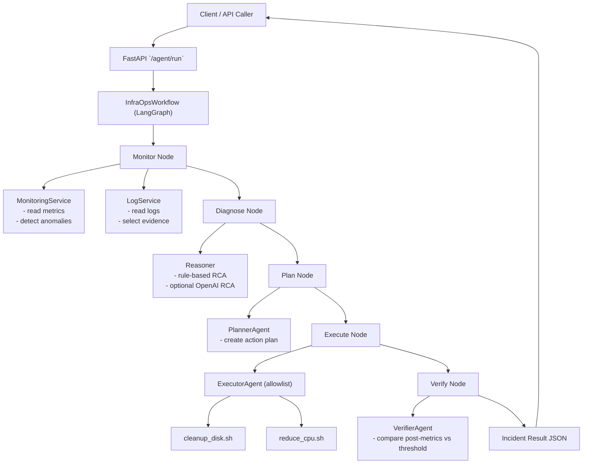

# Ops Agent Lab

FastAPI application that simulates an autonomous IT infrastructure agent:

- monitor metrics
- diagnose anomalies from metrics + logs
- plan actions
- execute automation scripts
- verify incident resolution

## Architecture

- `planner` agent: builds action plan from anomalies
- `executor` agent: runs allowed shell automations
- `verifier` agent: validates post-execution metrics

Workflow is implemented with LangGraph in:
`app/agent/workflow.py`

### Runtime Flow



### Component Communication

1. `FastAPI` receives incident payload and calls `InfraOpsWorkflow.run()`.
2. `MonitoringService` and `LogService` provide metrics/log evidence for anomaly detection.
3. `Reasoner` generates root-cause analysis (heuristic or OpenAI if key is set).
4. `PlannerAgent` converts diagnosis into executable shell steps.
5. `ExecutorAgent` runs only allowlisted scripts for safety.
6. `VerifierAgent` validates if metrics returned below threshold and sends final status.

## Quickstart

```bash
python -m venv .venv
source .venv/bin/activate
pip install -r requirements.txt
uvicorn app.main:app --reload
```

Open API docs at:
`http://127.0.0.1:8000/docs`

## Observability Sources

Default mode uses local sample files.  
You can switch to real sources via environment variables:

```bash
# Metrics source: sample | prometheus
export METRICS_SOURCE=prometheus
export PROMETHEUS_URL=http://localhost:9090

# Logs source: sample | loki
export LOGS_SOURCE=loki
export LOKI_URL=http://localhost:3100
export LOKI_QUERY='{job="varlogs"}'
```

Fallback behavior:
- If Prometheus/Loki is unreachable or returns empty data, app falls back to sample metrics/log files.

## Run Example

```bash
curl -X POST http://127.0.0.1:8000/agent/run \
  -H "Content-Type: application/json" \
  -d '{"incident":"Disk usage > 90%"}'
```

## Optional LLM RCA

Set `OPENAI_API_KEY` to enable LLM-assisted diagnosis. If not set,
the app uses deterministic rule-based diagnosis.

```bash
export OPENAI_API_KEY=your_key_here
```

## RCA Context & History

Roadmap-2 features now included:
- context-windowed diagnosis from recent incident history
- confidence calibration using evidence + anomaly count + history overlap
- incident history persistence in local JSONL store

Configuration:

```bash
export RCA_CONTEXT_WINDOW=5
export INCIDENT_HISTORY_PATH=app/data/incident_history.jsonl
```

Inspect RCA history via API:
`GET /incidents/history?limit=20`

## Tests

```bash
pytest -q
```

## Next Roadmap

- **Roadmap 1 - Real observability integration**
  Replace sample files with Prometheus query API and log backends (Grafana Loki/Elastic).
  Current status: Prometheus + Loki integration with fallback to sample is implemented.
- **Roadmap 2 - Smarter RCA**
  Add context windowing, incident history, and confidence scoring calibration.
  Current status: context window + incident history + confidence calibration implemented.
- **Roadmap 3 - Automation safety**
  Add dry-run mode, approval gates, rollback steps, and policy-based command execution.
- **Roadmap 4 - Multi-agent specialization**
  Split planner/executor/verifier into independently scalable workers with queue-based orchestration.
- **Roadmap 5 - Ops dashboard**
  Build a web UI for incident timeline, evidence trace, action logs, and verification reports.
- **Roadmap 6 - Production readiness**
  Add auth, audit logs, integration tests, chaos scenarios, and deployment manifests.
